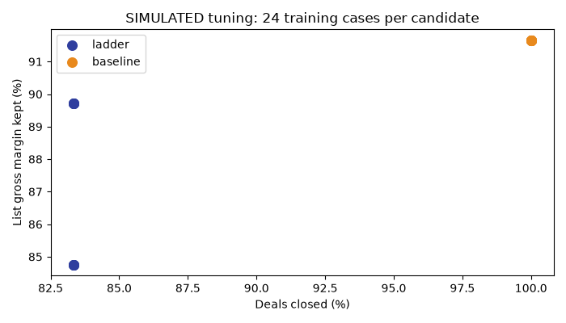

# SIMULATED tuning

Eight configurations, both brains, 24 training cases per brain, seed 1007. Final evaluation uses 200 cases per brain, seed 7, disjoint seeds. This is synthetic validation, not generalisation evidence. Select maximum saved score subject to zero violations and full independent truthfulness. Ties follow stable candidate order.

Selected: {"brain": "baseline", "safety_buffer_paise": 0, "quantity_tiers": {"1": 0, "3": 300, "6": 600}, "bundle_discount_bps": 200, "final_offer_round": 5, "walk_round": 8}

All trials: outputs/SIMULATED_tuning.json. Final results: outputs/summary.json. Baseline concessions are explicitly time-based; the ladder-only promise applies only to the ladder strategy.